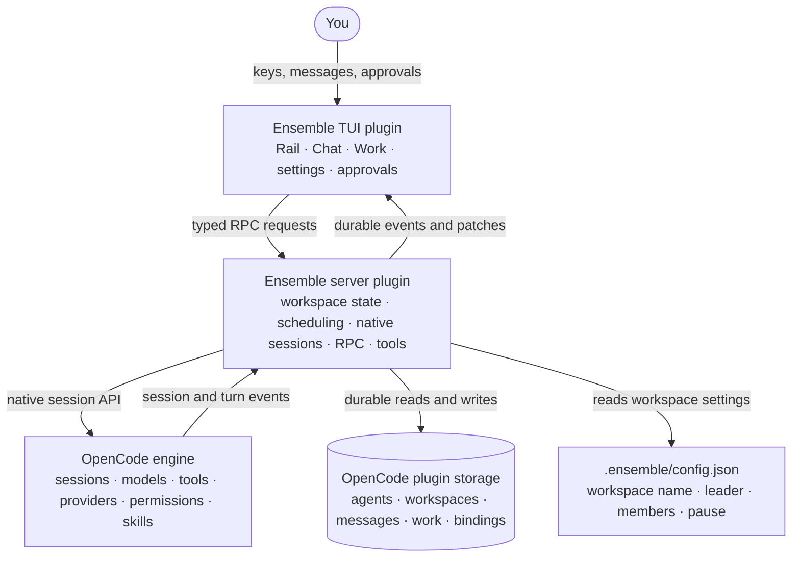

# Architecture overview

Ensemble is a TUI workspace plus a server plugin inside OpenCode. The server owns
team state and scheduling; OpenCode owns execution, models, tools, and
permissions. The TUI renders the team view.

## What you see

- **The page is a client.** Closing the Ensemble page does not stop native work.
  Reopening it restores the selected workspace, focused work item, and focused
  pane.
- **State survives restarts.** Agents, workspaces, messages, work items,
  bindings, memories, and approvals are durable. A restart reconciles live work
  rather than rewriting a running turn.
- **Execution stays underneath.** Selecting a work item and pressing `o` opens
  the native session where the agent actually ran. Tool activity, model calls,
  and permissions remain OpenCode's.
- **Nothing is hosted.** Ensemble runs locally as an OpenCode plugin. It has no
  hosted service, model, or telemetry. Workspace config is a file in the
  project; conversation history stays in OpenCode storage.

## Mental model

Three components have distinct jobs:

- **TUI plugin.** Renders the rail, chat, Work, settings, and approvals. It sends
  typed RPC requests and applies the events the server publishes. It is a
  disposable view, not a second writer.
- **Server plugin.** Owns the workspace registry, roster, task tree,
  scheduler, memory, approvals, session bindings, RPC, and tool registrations.
  It is the single authority for team state and recovery.
- **OpenCode engine.** Owns sessions, models, tools, providers, permissions, and
  skills. Ensemble does not replace them.

Durable state is split by ownership:

| State | Where it lives |
|---|---|
| Agents, workspaces, messages, work items, bindings, memories, approvals | OpenCode plugin storage |
| Workspace name, leader, members, synthesis, pause | `<workspace>/.ensemble/config.json` |
| Handoffs and init metadata | `<workspace>/.ensemble/` |
| Conversation history | OpenCode storage, not the repository |

One Ensemble service runs per host realm and is shared by every OpenCode
location in that realm. That is why the same roster and workspace membership
appear in every location. The service reference-counts locations; the last one
to release stops it. A second process is not a supported writer.

*Figure: the TUI is a disposable view; the server owns team state; the OpenCode engine owns execution.*

The server is authoritative because the same team state must serve the page, the
native sessions, and every OpenCode location. The TUI can be closed, reloaded,
or reconnected without becoming a source of truth.

## Example

You start a long turn in **Acme Notes** and press `Space q` to leave Ensemble
for the native OpenCode interface. The turn keeps running in the server; closing
the page did not stop it. You return with `F2`, and the chat and Work pane show
the current state. Press `o` on the work item to inspect the native session
where the agent ran.

If OpenCode restarts during the turn, Ensemble recovers the durable work instead
of inventing a new result. A live claim with a valid lease stays with its owner;
an expired claim can be requeued with its attempt history preserved.

## Next

- [Concepts index](README.md): the full learning path.
- [Guides](../guides/README.md): apply the model to a task.
- [Reference](../reference/README.md): configuration, storage, and diagnostics.

## Go deeper

- [ADR 0003: Single service and safe recovery](../adr/0003-single-service-and-safe-recovery.md)
- [ADR 0002: Durable patch feed](../adr/0002-durable-patch-feed.md)
- [ADR 0010: Native turn ingestion](../adr/0010-native-turn-ingestion.md)
- [Implementation notes: architecture](../implementation.md#architecture)
