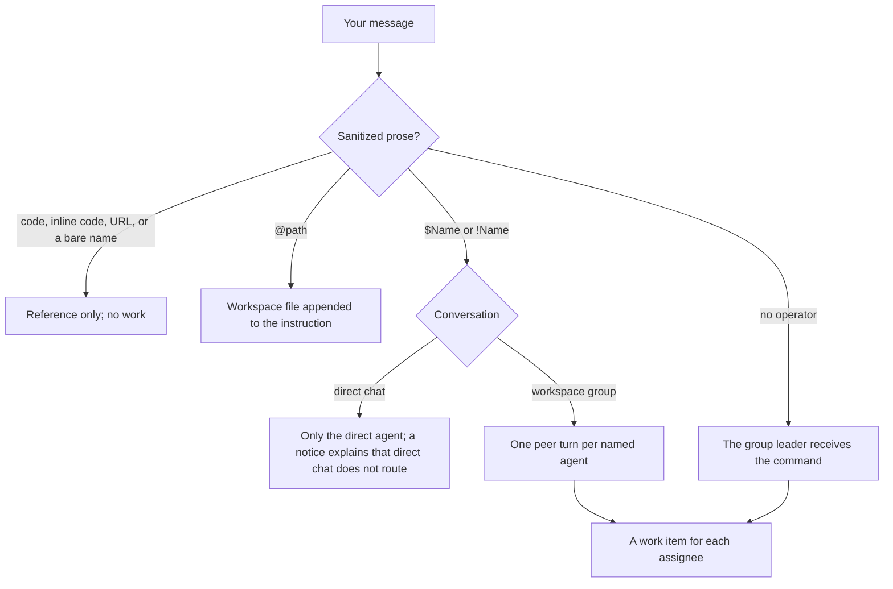

# Conversations and routing

A workspace group chat is shared. A direct chat is private to you and one agent.
Routing decides which of those conversations receives a message and which agent
gets a work item from it.

## What you see

- **Group chat.** Select a workspace to open its group chat. The transcript
  includes your messages, agent replies, work results, and system notices. The
  composer accepts `$` for an agent, `@` for a workspace file, and `/` for a
  command or skill.
- **Direct chat.** Select an agent to open its direct chat. Only that agent
  answers. A `$Name` in a direct chat creates no work and shows a notice
  explaining that direct chat stays one-to-one.
- **Mentions.** `$Name` inserts an agent reference and sends work to that agent
  in a workspace group. `!Name` is an accepted alias.
- **References.** A bare name is only text. `@path` is a workspace file
  reference, never an agent or a skill. `\$` writes a literal dollar sign.
- **Refusals.** An unknown agent in the composer rejects the message with a
  clear error and keeps your draft. An unknown agent in an agent's native reply
  posts the reply, creates no work, and adds a visible notice naming the
  problem.

## Mental model

Every message belongs to one **conversation channel**. A conversation channel
scopes the transcript, the messages, the native turns, and the Work history. The
workspace group is one conversation channel; each direct chat is a separate
channel. A message or work item therefore belongs to exactly one conversation,
and a direct message cannot create group work.

Routing reads **sanitized prose** only:

| Form | Meaning |
|---|---|
| `$Name` | Send a peer turn to that agent in the workspace group |
| `!Name` | Accepted alias of `$Name` |
| bare name | A reference only; creates no work |
| `@path` | A workspace file reference; never an agent |
| `\$` | A literal dollar sign, not a routing operator |

Fenced code, inline code, URLs, and file paths never route. A name inside a code
sample is documentation, not a request. This is why agents can write technical
prose without accidentally assigning work.

In a group chat, a message with no mention goes to the leader. A message with
one or more mentions goes to each named agent: one work item per unique
recipient. Self-mentions and duplicate recipients collapse. A direct chat
addresses only the selected agent; the routing grammar does not apply there.

**Assignment** is the link between a message and the agent who owns the
resulting work item. Sending an addressed message assigns a turn to that agent.
The leader can delegate or reassign work to another member. Reassignment changes
the assignee of an existing work item; it does not move the conversation, and it
does not change workspace membership.

Routing is not a second scheduler. It decides the recipients and hands the
resulting turns to the same queue, budget, and Work machinery described in the
next pages.

## Example

In the **Acme Notes** group chat you send `$Grace check the sync bug`. Grace gets
a peer turn and a work item; Ada, the leader, does not receive the command. You
then send "Grace is researching the sync bug". That bare name is a reference, so
no new work is created.

In Grace's direct chat, `$Linus review this` creates no work. A notice reminds
you that direct chat stays one-to-one. To ask Linus for a review, send the
message in the workspace group or open Linus's direct chat.

## Next

- [Turns and synthesis](turns-and-synthesis.md): what happens after routing.
- [Guides](../guides/README.md): group chat, direct chat, and `@path` workflows.
- [Reference](../reference/README.md): exact mention and file-reference syntax.

## Go deeper

- [ADR 0011: Mention routing and budgets](../adr/0011-mention-routing-and-budgets.md)
- [ADR 0009: Conversation identity and sessions](../adr/0009-conversation-identity-and-sessions.md)
- [Implementation notes: group chat](../implementation.md#group-chat)
