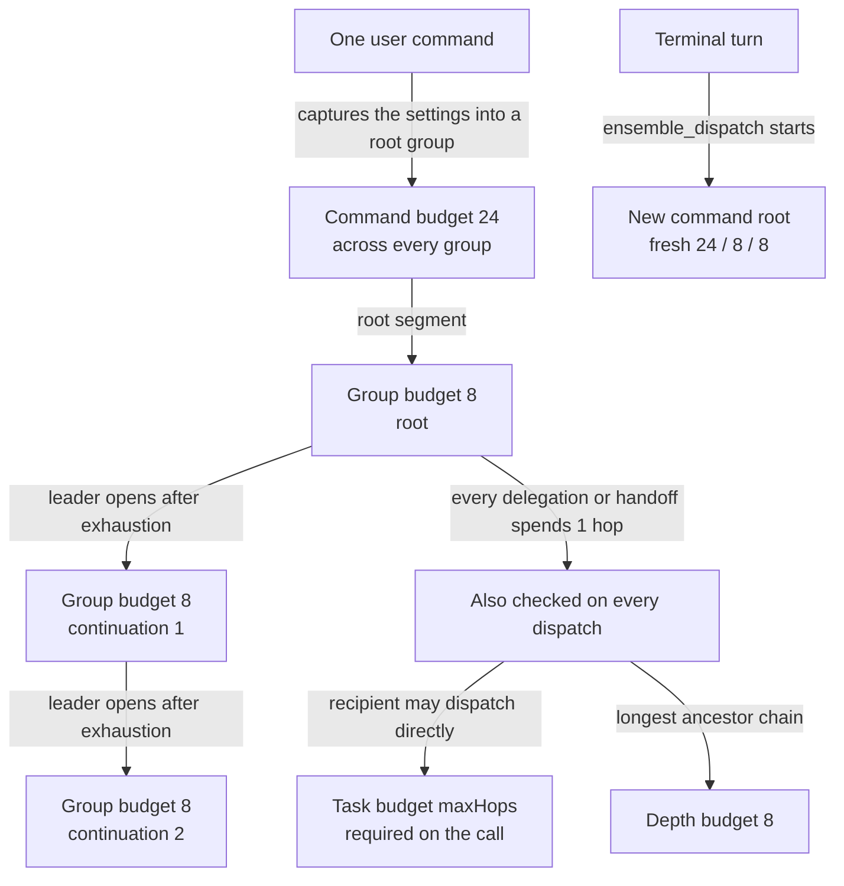

# Dispatch budgets

A dispatch budget is the layered ceiling on how much work one command can cause.
It stops a relay or a chain of delegations from running without a visible bound.

## What you see

- **On a work item.** The Work header shows the group and command budget, for
  example `hops 3/8 · cmd 21 left`. Compact rows shorten the same numbers.
- **On a group header.** The header shows hop and command remaining, marks an
  exhausted group `EXHAUSTED`, and labels a continuation segment `CONT N · from
  root`.
- **In a tool result.** An agent sees task, group, command, and depth remaining,
  so it can decide whether to dispatch, return to the leader, or stop.
- **In a refusal.** The message names the exhausted layer and the next action:
  return to the leader, continue in a new group, or ask you for a new command.
  A budget stop is a controlled stop, not a **FAILED** work item.
- **In settings.** `:limits` or the leader menu edits group hops, command hops,
  depth, and the continuation count. Changes apply to new commands only.

## Mental model

Four layers bound work, each with one owner:

| Layer | Bounds | Owner | Default | Allowed |
|---|---|---|---|---|
| Command | Every hop for one user command, across all groups | You, in settings | 24 | 8, 16, 24, 32, 40, 48 |
| Group | Hops inside one group segment | You for the root; the leader for a continuation | 8 | 8, 16, 24 |
| Task | Direct dispatches the recipient of a delegation or handoff may make | The dispatching agent, on the call | Required | Any integer ≥ 0 |
| Depth | The longest ancestor chain inside one group segment | You, in settings | 8 | 1 to 16 |

The defaults produce a 24-hop command made of one root group and up to two
8-hop continuation groups. The settings are validated together: command hops
cannot be below group hops, and the continuation count must fit at the smallest
allowed 8-hop group.

**What consumes a hop.** A user command and its initial recipients consume
nothing. An agent-created delegation or explicit handoff consumes one group and
one command hop. Opening a continuation consumes nothing; its first work item
consumes one. Completion handoffs, batch review, synthesis, peer turns, retries,
restarts, recovery, and idempotent replays consume nothing. Cancellation does
not refund a hop.

**The task budget is not a reservation.** It counts the direct dispatches the
recipient may make, not a reserved subtree. `maxHops: 0` is a deliberate
one-shot ask: the recipient can answer and finish but cannot create more work.
The group and command caps remain the hard subtree limit. Every explicit
delegation and handoff requires the argument; a missing value is a validation
error, never a silent default.

On the native path, an agent asks with `$Name` and does not author a budget; the
server derives any task budget for work that spends a hop. The explicit
migration tools still require `maxHops` while they remain available.

**Refusal order** is task, closed group, group, depth, command, then per-run
fan-out. The first exhausted layer is the one named, so the agent learns which
limit to work within.

**Continuation.** A continuation is a leader-only, linked segment of the same
command. The referenced group must be exhausted, the new segment's
`groupMaxHops` tier must fit the command remaining, and the continuation count
must be below its maximum. Opening one seals the parent as `continued`, starts a
fresh depth segment, and leaves command counters on the root. Later leader
dispatches join the newest active continuation automatically. This is different
from a **terminal continuation**, which starts a new command with a fresh
ledger.

## Worked example

You send one command in **Acme Notes**: "Prepare the release note." The command
starts with 24 command hops, an 8-hop root group, and a depth ceiling of 8.

The example uses explicit delegation, the path that spends hops directly. A
normal `$Name` peer turn spends no hop; it is bounded by the per-message cap,
depth, and cycle guard.

Ada, the leader, receives the command. She delegates research to Grace with
`maxHops: 1` and drafting to Linus with `maxHops: 1`.

| Step | Action | Group | Command |
|---|---|---|---|
| 1 | Ada delegates research to Grace (`maxHops: 1`) | 1/8 | 1/24 |
| 2 | Ada delegates drafting to Linus (`maxHops: 1`) | 2/8 | 2/24 |
| 3 | Grace delegates a fact check to Sam (`maxHops: 0`) | 3/8 | 3/24 |
| 4 | Linus delegates an edit to Mira (`maxHops: 0`) | 4/8 | 4/24 |
| 5 | Ada asks Sam for a final check (`maxHops: 0`) | 5/8 | 5/24 |
| 6 | Ada asks Mira to format the draft (`maxHops: 0`) | 6/8 | 6/24 |
| 7 | Ada asks Grace for a follow-up (`maxHops: 0`) | 7/8 | 7/24 |
| 8 | Ada asks Linus to apply the edit (`maxHops: 0`) | 8/8 | 8/24 |
| 9 | Ada tries one more delegation | refused: group | 16 left |

Grace and Linus each had a task budget of 1, so each could make exactly one
direct dispatch. Sam and Mira each received a one-shot ask. Depth stayed at 2,
well below the ceiling of 8.

The group is now exhausted, but the command still has 16 hops and the
continuation count is 2. Ada opens a continuation with `groupMaxHops: 8`. That
spends no hop. The first work item in the continuation spends one:

| Action | Group | Command |
|---|---|---|
| Ada opens continuation 1 (8-hop tier) | 0/8 continuation | 8/24, 16 left |
| First continuation work item | 1/8 continuation | 9/24, 15 left |

When the command's 24 hops are spent, or the continuation count is used up, the
next refusal tells Ada to ask you for a new command. A new command captures a
fresh 24/8/8 ledger; the old command cannot be extended.

## Next

- [Native sessions](native-sessions.md): where each turn actually runs.
- [Guides](../guides/README.md): set limits and run a delegated workflow.
- [Reference](../reference/README.md): the exact settings fields and tiers.

## Go deeper

- [ADR 0004: Dispatch budgets and continuation](../adr/0004-dispatch-budgets-and-continuation.md)
- [ADR 0012: Terminal turns and root synthesis](../adr/0012-terminal-turns-and-root-synthesis.md)
- [Implementation notes: dispatch budgets](../implementation.md#dispatch-budgets)
