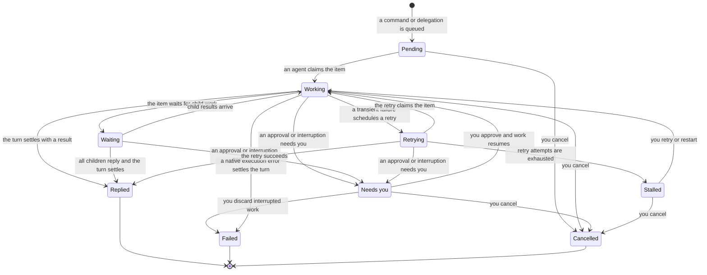

# Work lifecycle

Every unit the team runs appears as a **work item** in the Work pane. Its status
tells you whether it is queued, running, waiting on someone, waiting on you, or
finished.

## What you see

- **ACTIVE.** Work opens in ACTIVE and shows non-terminal work items: queued,
  working, waiting, retrying, needs you, and stalled.
- **HISTORY.** Press `f` to switch to HISTORY. It holds terminal work items:
  replied, failed, and cancelled. A dispatch group can appear in both views, with
  different work items in each.
- **Header.** Each work item shows the assignee name, the status word with its
  glyph, and a budget label such as `hops 3/8 · cmd 21 left`.
- **Actions.** `Enter` opens the focused result. `d` delegates, `t` reassigns,
  `r` retries, `R` restarts, `x` cancels, and `o` opens the assignee's native
  session. A work item advertises only the actions its current status allows.
- **Needs you.** A pending approval or an interrupted run keeps its work item in
  ACTIVE and pins the approvals summary under Work. It stays until you resolve
  the decision.
- **History is read-only.** Terminal work items are display-only. They remain
  under the existing finished-work retention rather than a separate archive
  policy.

## Mental model

A work item is either queued or running work with an assignee, or a native turn
without a lease, claim, or attempt count. The Work pane is a view over the
conversation's task tree. It is not a second task store and not a second
scheduler.

**Status is derived, not stored as a label.** Ensemble reads durable delivery
and execution facts and derives one status. That is why a live run beats an old
timestamp and why a late answer can correct a temporary notice.

| Status | Meaning |
|---|---|
| Pending | Queued and not yet claimed. The work item reads **QUEUED**. |
| Working | An agent holds a live run or lease. |
| Waiting | The item is waiting for its child work to settle. |
| Retrying | A transient failure scheduled a retry, or a lost lease is still within its attempts. |
| Needs you | An approval, interruption, or blocked native permission needs your decision. |
| Replied | The turn or work item settled successfully. |
| Failed | A native execution or model error. |
| Stalled | Delivery, lease, or attempt exhaustion without a native error. |
| Cancelled | You explicitly stopped the work. |

**Failed and stalled are different.** Failed means the agent's execution really
errored. Stalled means Ensemble could not deliver or keep the work alive; no run
starts while it is stalled, and it stays visible until you retry, restart, or
cancel it. A recovered answer supersedes an earlier retry or failure notice.

**ACTIVE and HISTORY split by work item, not by group.** A finished work item
leaves ACTIVE immediately and moves to HISTORY even while its group still has
live work. Terminal means replied, failed, or cancelled; stalled is not
terminal.

## Example

Grace's **Audit sync bug** work item starts as **QUEUED**. A run claims it and
the work item becomes **WORKING**. A transient provider failure schedules a
retry, so it reads **RETRYING** with `retry <n>s · <attempt>/5`. The retry
succeeds and the work item becomes **REPLIED**, then leaves ACTIVE for HISTORY.

If the same run had hit a real model error, the work item would read **FAILED**.
If delivery attempts had run out without a native error, it would read
**STALLED** and stay in ACTIVE until you retry, restart, or cancel it.

## Next

- [Dispatch budgets](dispatch-budgets.md): why a work item can stop without
  failing.
- [Guides](../guides/README.md): focus, page, and act on work items.
- [Reference](../reference/README.md): the exact status words and keys.

## Go deeper

- [ADR 0005: Work status and delivery/lease separation](../adr/0005-work-status-and-delivery-lease-separation.md)
- [ADR 0008: Task-level history and rollup](../adr/0008-task-level-history-and-rollup.md)
- [ADR 0006: Three-pane workspace shell](../adr/0006-three-pane-workspace-shell.md)
