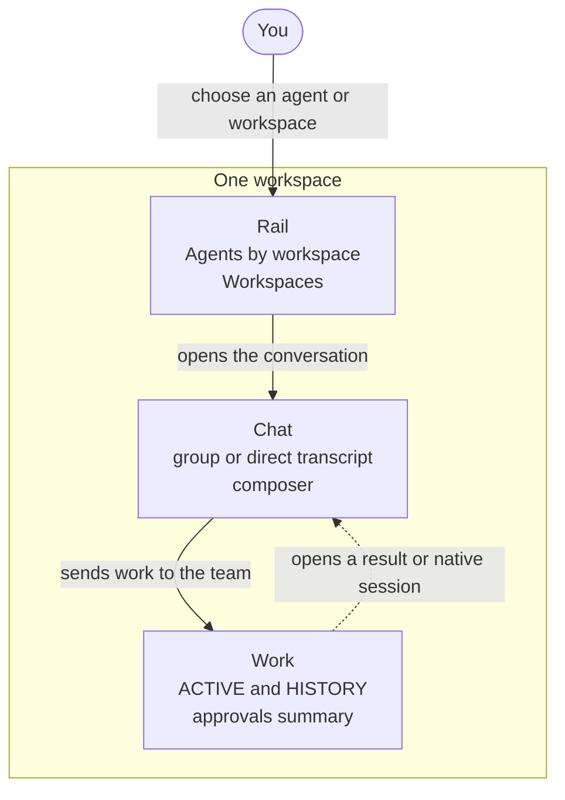

# The workspace shell

Ensemble opens on one workspace with three stable panes: a rail on the left, the
chat in the center, and Work on the right. Each pane answers a different
question: where you are, who is talking, and what the team is doing.

## What you see

- **Rail.** The left pane has two sections. **Agents** groups each agent once
  under its primary workspace, with the role as its subline and a leader marker
  next to the leader's name. **Workspaces** lists the project directories you
  can open. A workspace can show an unread marker, a busy marker, or a paused
  marker.
- **Chat.** The center pane shows the selected conversation: a workspace group
  chat or a direct chat with one agent. Final messages, streaming replies, and
  work results share one transcript. The composer sits below the transcript and
  takes `$`, `@`, and `/` completions.
- **Work.** The right pane shows work items in **ACTIVE** by default. Press `f`
  to switch to **HISTORY**. Pending approvals appear as a small summary under
  Work; `v` opens the full approvals view.
- **Width.** At 118 columns or wider you see three full panes. Between 96 and
  117 columns Work becomes compact. Below 96 columns Work becomes a right
  drawer. `Space b l` and `Space b r` toggle the left and right columns at any
  width, and the choice survives a restart.

<DocsFigure
  src="/media/workspace-shell.png"
  alt="Three-pane Ensemble workspace at 140 columns: the rail lists Ada, Nova, and Rook under acme-notes; the chat shows a group message; Work shows Ada's WORKING work item with the hop budget."
  caption="The three-pane shell in the synthetic Acme Notes fixture. Work is active while Ada writes the release note. Select the image to open the full-size capture."
  width="1400"
  height="800"
/>

## Mental model

The three panes are three views over one workspace, not three stores:

- The rail is navigation over your roster and workspace list.
- The chat is the durable team record and the place where routing happens.
- Work is a live projection of the conversation's work items, grouped by the
  command that caused them.

One workspace is open at a time. Selecting an agent opens its direct chat;
selecting a workspace opens its group chat. Settings and approvals are further
surfaces over the same workspace state, so a change in one pane appears in the
others without a separate refresh step.

*Figure: one workspace, three views. The rail navigates, chat records and routes, and Work projects the resulting work items.*

The shell is deliberately stable: focus moves between panes, but the pane
layout does not change when you open a result, start a turn, or resolve an
approval. That keeps the same spatial memory working across a long session.

## Example

You open the **Acme Notes** workspace at `~/dev/acme-notes`. The rail highlights
the workspace, the chat shows the group transcript, and Work shows the most
recent command's work items. You send "Summarize the open issues" without naming
an agent. The leader, Ada, receives the command and answers in the group chat or
delegates to a teammate; Work shows a work item for each agent that ran.

When a work item finishes, it leaves ACTIVE and appears in HISTORY. Press `o` on
a focused work item to open that agent's native session, then `F2` to return to
the shell.

## Next

- [Agents, workspaces, and the leader](agents-and-workspaces.md): who receives
  a message.
- [Guides](../guides/README.md): pane actions and task walkthroughs.
- [Reference](../reference/README.md): exact keys, commands, and settings.

## Go deeper

- [ADR 0006: Three-pane workspace shell](../adr/0006-three-pane-workspace-shell.md)
- [ADR 0008: Task-level history and rollup](../adr/0008-task-level-history-and-rollup.md)
- [Implementation notes: workspace shell](../implementation.md#workspace-shell)
